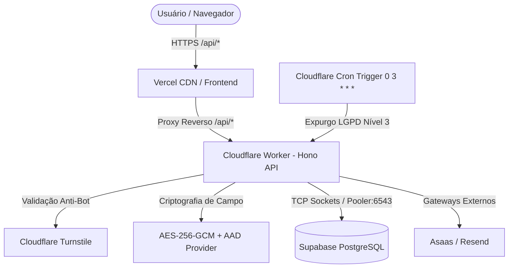

# ADR-006: Modernização do Backend em Cloudflare Workers com Hono, Drizzle ORM e Supabase

| Metadado | Detalhe |
| :--- | :--- |
| **Status** | **Aprovado** |
| **Data** | 2026-09-29 |
| **Decisores** | Senior Principal Engineer, Software Architect & AppSec Lead |
| **Consultados** | Time de Engenharia, Encarregado de Proteção de Dados (DPO) |
| **Repositórios** | `backend`, `frontend`, `documentation` |

---

## 1. Contexto & Problema

O ecossistema Pure Life Ministries Brasil adota estrategicamente uma topologia serverless moderna composta por **Vercel** (Frontend SSG/Islands), **Cloudflare Workers** (API / Regras de Negócio / Proteção na Borda) e **Supabase** (Banco de Dados PostgreSQL Gerenciado).

Durante a auditoria adversarial e de engenharia, foram identificados os seguintes gargalos e riscos arquiteturais:

1. **Bypass de Segurança no Frontend**: Formulários no frontend continham integrações legadas importando `@supabase/supabase-js`, tentando gravar dados de triagem diretamente no Supabase a partir do navegador do usuário. Esse caminho ignorava a camada de criptografia em repouso AES-256-GCM com AAD, a geração de código de referência de atendimento e a validação do Cloudflare Turnstile realizada na API.
2. **Incompatibilidade de Driver de Banco**: O backend utilizava `@neondatabase/serverless` e `drizzle-orm/neon-http`. O driver HTTP do Neon é incompatível com o pooler do Supabase PostgreSQL e não permite transações multi-query interativas (`db.transaction(async tx => ...)`), essenciais para a unidade de trabalho atômica (`createSubmissionWithConsent`).
3. **Roteamento Artesanal e Falta de Middlewares Padronizados**: O ponto de entrada do Cloudflare Worker (`src/index.ts`) operava com encadeamento manual de condicionais `if (path === ...)`, sem gerenciamento unificado de CORS por ambiente, cabeçalhos de segurança (HSTS, nosniff, frame-ancestors) e limites de corpo HTTP por rota.
4. **Resiliência de Chamadas Externas**: A validação do token do Cloudflare Turnstile não possuía timeout delimitado, expondo a execução do Worker a estouros de wall-clock time caso a API externa do Turnstile enfrentasse instabilidade.
5. **Rotina de Expurgo Crônica (Cron Purge)**: A seleção de registros expirados para expurgo criptográfico diário não limitava a cardinalidade da consulta (`LIMIT`), criando risco de timeout na rotina agendada da Cloudflare em bases com grande volume de registros retidos.

---

## 2. Decisão Arquitetural

Decidiu-se pela modernização e endurecimento do ecossistema, **preservando integralmente a arquitetura estratégica Vercel + Cloudflare Workers + Supabase**:

### 2.1. Eliminação do Bypass Client-Side & Centralização na API

- **Remoção de `@supabase/supabase-js` do frontend**: Todas as submissões de dados (Triagem Pastoral, Contato, Newsletter e Doações PIX) foram redirecionadas estritamente para endpoints `/api/*`.
- **Configuração de Proxy Reverso no `vercel.json`**: Mapeamento seguro das rotas `/api/:path*` diretamente para a borda do Cloudflare Worker (`https://api.purelifeministriesbrasil.org/api/:path*`), mitigando problemas de CORS no navegador e mantendo os cabeçalhos de segurança na resposta.
- **Cabeçalhos Estritos de Privacidade**: Adição de `Cache-Control: no-store, private` e `Referrer-Policy: no-referrer` para todas as rotas sensíveis (`/triagem/(.*)`).

### 2.2. Adoção do Hono no Cloudflare Workers

- Adoção do framework ultraleve **Hono** para o Cloudflare Worker, utilizando:
  - `secureHeaders()` para aplicação automática de cabeçalhos OWASP nos responses.
  - `cors()` configurado dinamicamente para o `PUBLIC_SITE_ORIGIN` e origens de desenvolvimento autorizadas.
  - Middlewares de controle e mapeamento de rotas RESTful limpas.
  - Exportação canônica do ciclo de vida Cloudflare Workers (`fetch` e `scheduled`).

### 2.3. Migração do Driver Drizzle para `postgres.js` (TCP via Pooler)

- Substituição de `@neondatabase/serverless` por **`postgres.js` (`drizzle-orm/postgres-js`)**.
- Com `compatibility_flags = ["nodejs_compat"]`, o Cloudflare Workers conecta-se via sockets TCP diretamente ao Supabase Transaction Pooler (`sa-east-1.pooler.supabase.com:6543`).
- Configurações essenciais para serverless:
  - `max: 1`: Pool de conexão dimensionado por isolate do Worker.
  - `prepare: false`: Desativa prepared statements, obrigatório para operação estável em PgBouncer no modo Transaction.
  - Suporte completo e testado a transações atômicas interativas (`db.transaction`).

### 2.4. Porta Hexagonal e Timeout no Turnstile

- Criação da porta `BotProtectionPort` na camada de aplicação.
- Implementação do adaptador com limite estrito de tempo de espera via `AbortSignal.timeout(3000)` para fail-closed seguro caso a API da Cloudflare atrase.

### 2.5. Otimização de Lote no Expurgo Criptográfico

- Parametrização de `findExpiredSubmissions` com `limit: 500` na consulta Drizzle ORM, garantindo que o cron job execute em lotes seguros sem estourar limites de memória ou CPU.

---

## 3. Alternativas Rejeitadas

| Alternativa | Motivo da Rejeição |
| :--- | :--- |
| **Migrar backend para Google Cloud Run ou AWS** | Violação da decisão executiva de arquitetura. Introduziria custos fixos desnecessários, descarte da infraestrutura já provisionada na Cloudflare e maior latência global. |
| **Manter driver HTTP do Neon** | Incompatível com o banco Supabase em produção e impede transações interativas necessárias para a gravação atômica de consentimento e triagem. |
| **Gravação direta do navegador no Supabase com RLS** | Rejeitada por não conformidade com o Artigo 11 da LGPD. Dados pastorais sensíveis requerem cifragem forte em repouso antes de atingirem o armazenamento no banco, necessitando de chaves criptográficas que jamais devem ser expostas ao cliente. |

---

## 4. Consequências & Ganhos

### Consequências Positivas:
- **Segurança Reforçada**: 100% dos dados sensíveis passam por validação de esquema Zod, Turnstile anti-bot, cifragem AES-256-GCM com AAD e transação atômica no banco de dados.
- **Performance do Frontend**: Redução imediata de ~223 kB de JavaScript empacotado no cliente pela eliminação da biblioteca do Supabase no bundle.
- **Observabilidade e Manutenibilidade**: O roteamento via Hono reduz código boiler-plate, melhora legibilidade e possibilita testes de integração simplificados via `app.fetch`.
- **Compatibilidade Plena com Supabase**: Conexões TCP estáveis com o Transaction Pooler e suporte a migrações com Cloudflare Hyperdrive quando desejado.

### Trade-offs:
- Requer a flag `compatibility_flags = ["nodejs_compat"]` ativa no `wrangler.toml` (já configurada e padrão em Workers modernos).
- Exige atenção à configuração de `prepare: false` no cliente de banco de dados para evitar erros de sintaxe no PgBouncer do Supabase.
