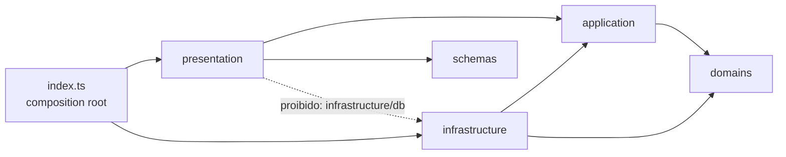

# Camadas do Backend (Clean Architecture)

O Worker em [`backend/src`](https://github.com/purelifeministriesbrasil/backend/blob/ca9737fb48cdcad70b7bfddfd9cb76ea65fd1e7d/src) é organizado em camadas com dependências apontando para dentro. A regra é **verificada automaticamente** em `pnpm lint` por [`scripts/verify-boundaries.mjs`](https://github.com/purelifeministriesbrasil/backend/blob/ca9737fb48cdcad70b7bfddfd9cb76ea65fd1e7d/scripts/verify-boundaries.mjs) e pelas regras `no-restricted-imports` de [`eslint.config.js`](https://github.com/purelifeministriesbrasil/backend/blob/ca9737fb48cdcad70b7bfddfd9cb76ea65fd1e7d/eslint.config.js). Baseline: backend `ca9737f`. Visão geral dos repositórios: [Repositórios](repositories-scope.md).

## 1. Camadas e conteúdo

| Camada | Pasta | Conteúdo real | Observação |
|---|---|---|---|
| Domínio | `domains/` | Apenas [`donations/state-machine.ts`](https://github.com/purelifeministriesbrasil/backend/blob/ca9737fb48cdcad70b7bfddfd9cb76ea65fd1e7d/src/domains/donations/state-machine.ts) | Hoje é uma única regra de transição, não uma coleção de domínios |
| Aplicação | `application/` | `usecases/` (triagem, contato, newsletter, PIX, evento de pagamento, expurgo de triagens e de contatos), `ports/` (interfaces) e `reference-code.ts` | Não conhece SDKs nem banco |
| Infraestrutura | `infrastructure/` | `config`, `crypto`, `db`, `email`, `http`, `observability`, `payments`, `security` | Implementa as portas |
| Apresentação | `presentation/` | Handlers HTTP em `forms/`, `donations/`, `webhooks/`, `health.ts`, `http.ts` e `cron/purge.ts` | Usa casos de uso por injeção |
| Contratos | `schemas/` | `common`, `triage`, `contact`, `newsletter`, `donations` (schema + tipos) | Só depende de Zod; ver [Schemas comuns](../schemas/common-schema.md) |
| Raiz | `index.ts` | Monta dependências, rotas Hono, middlewares e o handler `scheduled` | Único lugar que conecta infraestrutura à apresentação |

### Portas (`application/ports/`)

`bot-protection`, `contact-repository`, `donation-repository`, `encryption-provider`, `idempotency-repository`, `newsletter-repository`, `notifier`, `payment-gateway`, `result` (tipo de resultado) e `triage-unit-of-work`.

## 2. Regras verificadas

Do `verify-boundaries.mjs` (imports relativos resolvidos pelo caminho real) e do ESLint:

| Camada | Pacotes proibidos | Camadas proibidas |
|---|---|---|
| `domains` | `drizzle-orm`, `postgres`, `hono`, `resend`, `@neondatabase/*`, `cloudflare:*` | `application`, `infrastructure`, `presentation`, raiz |
| `application` | os mesmos | `infrastructure`, `presentation`, raiz |
| `infrastructure` | (nenhum) | `presentation`, raiz |
| `presentation` | `postgres`, `drizzle-orm`, `@neondatabase/*` | importar `infrastructure/db` diretamente |
| `schemas` | qualquer pacote exceto `zod` e `zod/mini` | todas as demais camadas e a raiz |

Regras gerais (todos os arquivos de `src/`): não usar `process.env` (o ambiente chega pelo objeto `env` do Worker); o ESLint também proíbe `Math.random()` (use `crypto`), `any` explícito e leitura de `import.meta.env.SECRET_*`/`PRIVATE_*`.

!!! note "Limite da verificação"
    O script examina `src/**/*.ts`. Não verifica `tests/` nem `scripts/`. O backend importa `zod` completo em `presentation/forms/newsletter.ts` (`confirmSchema`), fora de `schemas/`, o que as regras permitem.

## 3. Rotas (composition root)

| Método e caminho | Handler | Observações |
|---|---|---|
| `GET /health` | `health.ts` | Sem acesso ao banco |
| `POST /api/forms/triagem` | `forms/triagem.ts` | Turnstile, `Idempotency-Key` |
| `POST /api/forms/contato` | `forms/contato.ts` | Turnstile, `Idempotency-Key` |
| `POST /api/forms/newsletter` | `forms/newsletter.ts` | JSON ou formulário sem JavaScript |
| `POST /api/forms/newsletter/confirm` | `forms/newsletter.ts` | Token de confirmação |
| `POST /api/donations/create-pix` | `donations/create-pix.ts` | Exige gateway configurado |
| `POST /api/webhooks/payment` | `webhooks/payment.ts` | Assinatura do provedor |

Middlewares em `index.ts`: `secureHeaders` (Hono), CORS restrito para `/api/*`, e guardas específicas para `/api/forms/*` e `/api/donations/*`. Cron: `scheduled()` executa o expurgo ([Fluxos](sequence-diagrams.md#5-expurgo-lgpd-diario)).

## 4. Como adicionar um módulo

1. **Contrato**: crie o schema em `schemas/<modulo>/` e **copie-o byte a byte** para o `frontend/src/schemas/` (sincronização manual; ver R7).
2. **Porta**: declare a interface em `application/ports/`.
3. **Caso de uso**: implemente em `application/usecases/` usando só portas e `domains/`.
4. **Adaptador**: implemente a porta em `infrastructure/` (banco em `infrastructure/db/`, com tabela em `schema.ts` e migration nova em `drizzle/`; nunca edite uma migration aplicada).
5. **Handler**: crie em `presentation/` e registre a rota em `index.ts`.
6. **Dados sensíveis**: cifre com o `EncryptionProvider` e adicione um caso em `tests/canary.test.ts`.
7. **Verifique**: `pnpm verify` (lint + fronteiras + typecheck + testes).
