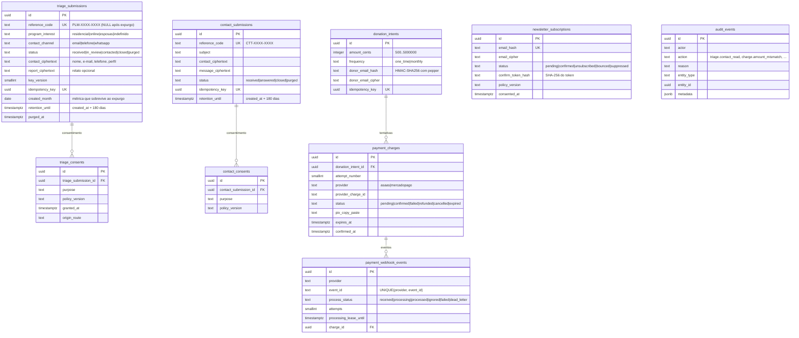

# Modelo de Dados Relacional (Neon Postgres)

Fonte de verdade: [`backend/drizzle/`](https://github.com/purelifeministriesbrasil/backend/tree/main/drizzle)
(`0001_initial.sql` + `0002_supabase_hardening_and_rls.sql`), espelhada coluna a coluna em
`backend/src/infrastructure/db/schema.ts`. Campos `*_ciphertext` / `*_cipher` são AES-256-GCM com IV próprio
(`*_iv`) e `key_version`; o AAD vincula `entidade:id:campo:versão`.

---

## 1. Diagrama Entidade-Relacionamento

---

## 2. Regras de integridade relevantes

| Constraint | Garante |
|---|---|
| `triage_purged_clean` / `contact_purged_clean` | Registro `purged` não guarda código, ciphertext nem IV |
| `contact_cipher_present` | Contato ativo sempre tem mensagem e contato cifrados |
| `charge_provider_unq` | Uma cobrança por `(provider, provider_charge_id)` |
| `charge_attempt_unq` | Uma cobrança por tentativa de cada intenção (idempotência de criação) |
| `webhook_idempotency_unq` | Um registro por evento do provedor (lease ADR-005) |
| `*_idempotency_unq` | Uma triagem / contato / intenção por `Idempotency-Key` |
| `intent_amount_chk` | R$ 5,00 a R$ 50.000,00 |

`set_updated_at()` mantém `updated_at` em `triage_submissions` e `payment_charges`.

---

## 3. Matriz de acesso

| Ator | Acesso |
|---|---|
| Worker (`postgres` via pooler) | Leitura/escrita conforme casos de uso; dados sensíveis só chegam cifrados |
| `anon`, `authenticated` (Data API) | **Nenhum**: RLS sem políticas + `REVOKE ALL` (inclusive privilégios padrão) |
| Equipe pastoral | Caixa pastoral (`scripts/pastoral-inbox.mjs`) com motivo obrigatório e registro em `audit_events` |
| Cron diário | Expurgo de triagens e contatos com `retention_until` vencido |

---

## 4. Retenção (LGPD)

| Dado | Retenção | Mecanismo |
|---|---|---|
| Triagem (contato + relato) | 180 dias | Cron `0 3 * * *` nulifica e marca `purged`; `created_month` permanece para métricas |
| Contato institucional | 180 dias | Mesmo cron |
| Newsletter | Até descadastro | Status `unsubscribed`/`suppressed` |
| Doações | Obrigação fiscal/contábil | Valores e status; e-mail do doador cifrado |
| Auditoria | Indeterminada (sem PII) | `ip_hash` pseudonimizado quando usado |
