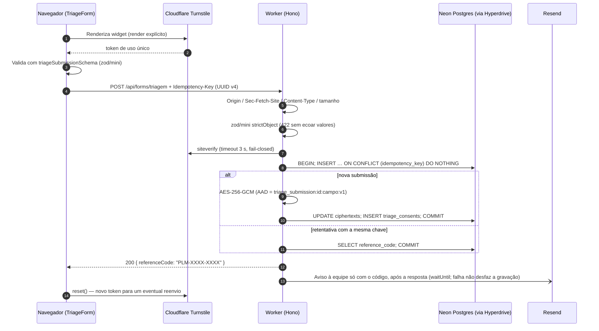
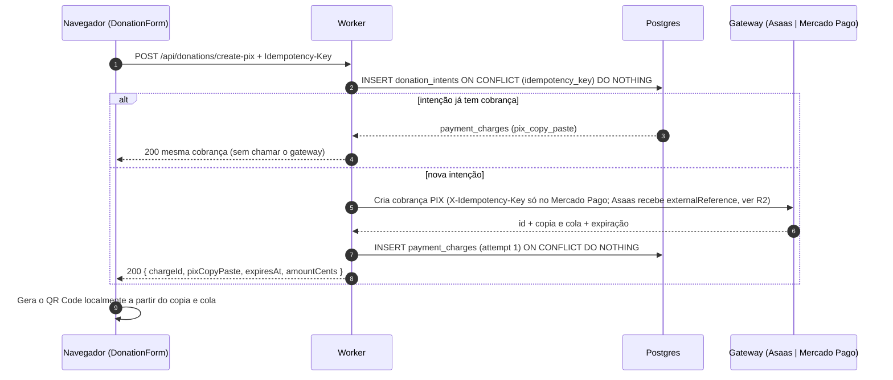
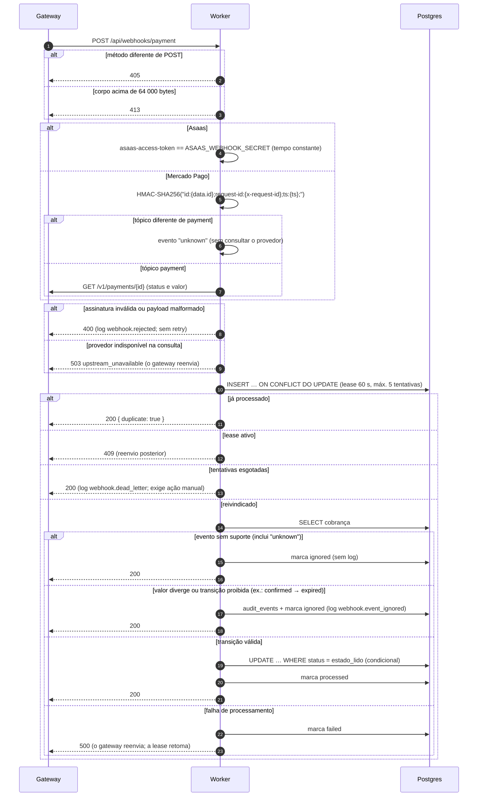
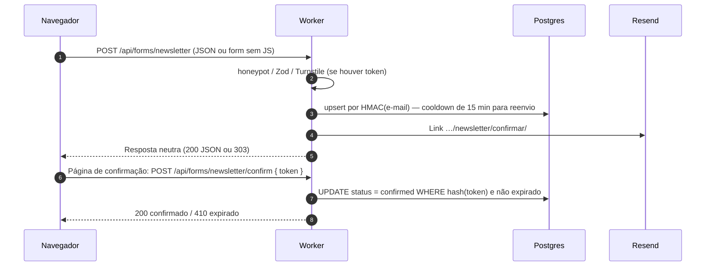
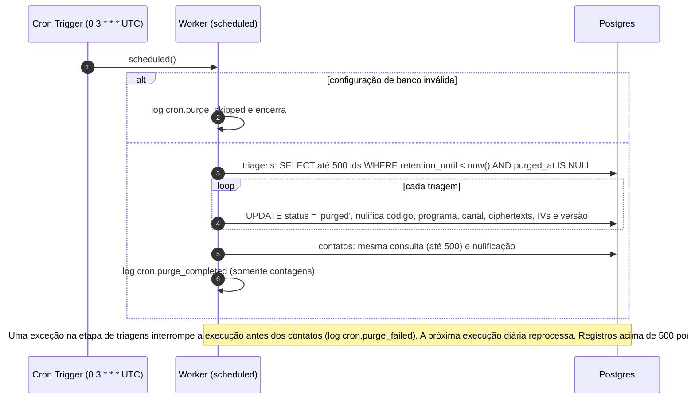
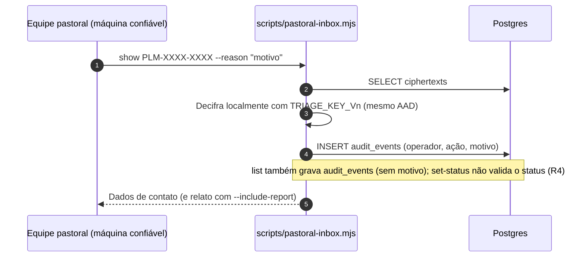

# Diagramas de Sequência

Fluxos reais implementados em `backend/src` e `frontend/src`. O navegador **nunca** acessa o banco: toda
escrita passa pelo Worker (`https://api.purelifeministriesbrasil.org`).

---

## 1. Triagem confidencial

## 2. Doação PIX

## 3. Webhook de pagamento

Evidência: [`presentation/webhooks/payment.ts`](https://github.com/purelifeministriesbrasil/backend/blob/ca9737fb48cdcad70b7bfddfd9cb76ea65fd1e7d/src/presentation/webhooks/payment.ts), [`mercadopago.ts`](https://github.com/purelifeministriesbrasil/backend/blob/ca9737fb48cdcad70b7bfddfd9cb76ea65fd1e7d/src/infrastructure/payments/mercadopago.ts), [`process-payment-event.ts`](https://github.com/purelifeministriesbrasil/backend/blob/ca9737fb48cdcad70b7bfddfd9cb76ea65fd1e7d/src/application/usecases/process-payment-event.ts); testes em `webhook.test.ts` e `gateways.test.ts`.

## 4. Newsletter (double opt-in)

## 5. Expurgo LGPD diário

Evidência: [`index.ts`](https://github.com/purelifeministriesbrasil/backend/blob/ca9737fb48cdcad70b7bfddfd9cb76ea65fd1e7d/src/index.ts) (`scheduled`), [`cron/purge.ts`](https://github.com/purelifeministriesbrasil/backend/blob/ca9737fb48cdcad70b7bfddfd9cb76ea65fd1e7d/src/presentation/cron/purge.ts), [`purge-repository.ts`](https://github.com/purelifeministriesbrasil/backend/blob/ca9737fb48cdcad70b7bfddfd9cb76ea65fd1e7d/src/infrastructure/db/purge-repository.ts); teste em `purge.test.ts`. Ver R3 em [Modelagem de Ameaças](../security/threat-model.md#5-riscos-e-pendencias-conhecidos).

## 6. Leitura pastoral

