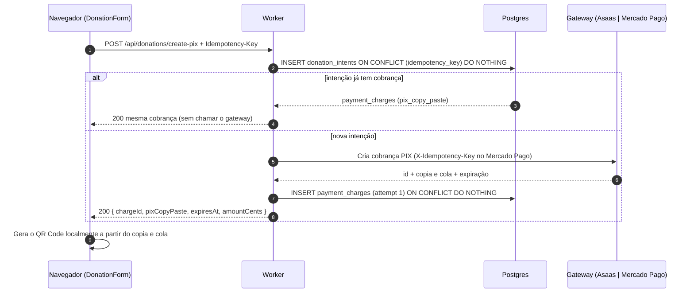
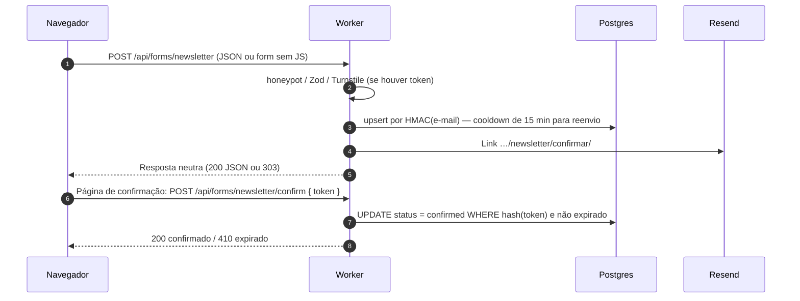
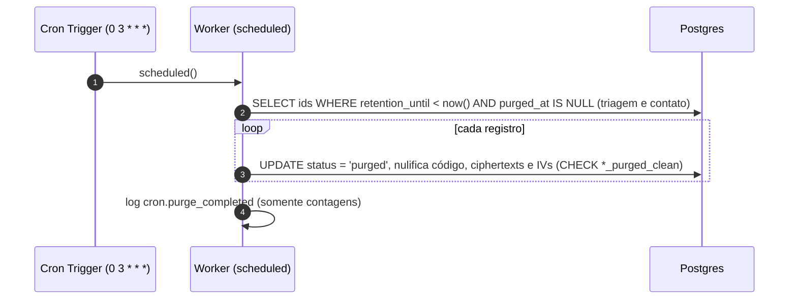
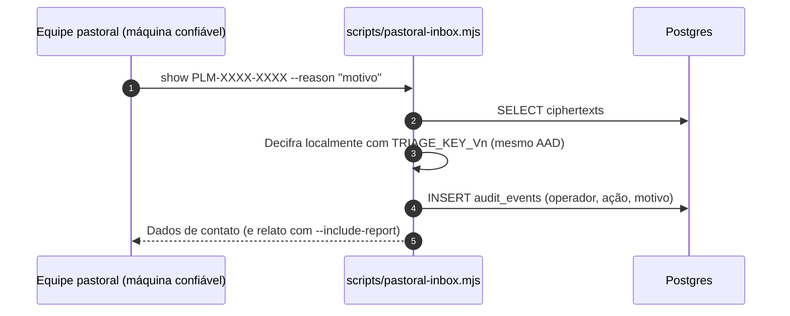

# Diagramas de Sequência

Fluxos reais implementados em `backend/src` e `frontend/src`. O navegador **nunca** acessa o banco: toda
escrita passa pelo Worker (`https://api.purelifeministriesbrasil.org`).

---

## 1. Triagem confidencial

```mermaid
sequenceDiagram
    autonumber
    participant B as Navegador (TriageForm)
    participant T as Cloudflare Turnstile
    participant W as Worker (Hono)
    participant DB as Neon Postgres (via Hyperdrive)
    participant R as Resend

    B->>T: Renderiza widget (render explícito)
    T-->>B: token de uso único
    B->>B: Valida com triageSubmissionSchema (zod/mini)
    B->>W: POST /api/forms/triagem + Idempotency-Key (UUID v4)
    W->>W: Origin / Sec-Fetch-Site / Content-Type / tamanho
    W->>W: zod/mini strictObject (422 sem ecoar valores)
    W->>T: siteverify (timeout 3 s, fail-closed)
    W->>DB: BEGIN; INSERT … ON CONFLICT (idempotency_key) DO NOTHING
    alt nova submissão
        W->>W: AES-256-GCM (AAD = triage_submission:id:campo:v1)
        W->>DB: UPDATE ciphertexts; INSERT triage_consents; COMMIT
    else retentativa com a mesma chave
        W->>DB: SELECT reference_code; COMMIT
    end
    W-->>B: 200 { referenceCode: "PLM-XXXX-XXXX" }
    W-)R: Aviso à equipe só com o código, após a resposta (waitUntil; falha não desfaz a gravação)
    B->>T: reset() — novo token para um eventual reenvio
```

## 2. Doação PIX



## 3. Webhook de pagamento

```mermaid
sequenceDiagram
    autonumber
    participant G as Gateway
    participant W as Worker
    participant DB as Postgres

    G->>W: POST /api/webhooks/payment
    alt Asaas
        W->>W: asaas-access-token == ASAAS_WEBHOOK_SECRET (tempo constante)
    else Mercado Pago
        W->>W: HMAC-SHA256("id:{data.id};request-id:{x-request-id};ts:{ts};")
        W->>G: GET /v1/payments/{id} (status e valor)
    end
    W->>DB: INSERT … ON CONFLICT DO UPDATE (lease 60 s, máx. 5 tentativas)
    alt já processado
        W-->>G: 200 duplicate
    else lease ativo
        W-->>G: 409 (reenvio posterior)
    else reivindicado
        W->>DB: SELECT cobrança
        alt valor diverge ou transição proibida (ex.: confirmed → expired)
            W->>DB: audit_events + marca ignored
        else transição válida
            W->>DB: UPDATE … WHERE status = estado_lido (condicional)
            W->>DB: marca processed
        end
        W-->>G: 200
    end
```

## 4. Newsletter (double opt-in)



## 5. Expurgo LGPD diário



## 6. Leitura pastoral


