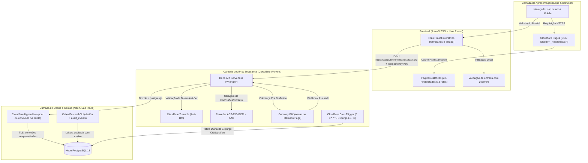

# Visão Geral do Sistema e Arquitetura

O sistema Pure Life Ministries Brasil adota uma arquitetura orientada a serviços leves e serverless, com separação rígida entre a camada de apresentação na borda, a API de regras de negócio/segurança e a camada de persistência confidencial.

---

## 1. Topologia do Sistema

---

## 2. Componentes Principais

### A. Frontend Web (`frontend`)
- **Framework**: Astro 5 configurado com `output: 'static'`.
- **Estilização**: Tailwind CSS v4 com tokens unificados na folha global. Zero atributos `style` inline (auditado no build).
- **Acessibilidade & Movimento**: Respeito estrito a `prefers-reduced-motion: reduce`, atributos ARIA dinâmicos (`aria-live`, `role="alert"`, `aria-describedby`) e foco visível em todos os controles interativos.
- **Roteamento Seguro**: Nenhum cliente de banco de dados no bundle. Todas as submissões vão direto à API (`PUBLIC_API_URL`), com CORS restrito à origem do site e CSP gerado com hashes no build.
- **Performance**: ilhas em **Preact** (`preact/compat`), schemas com **`zod/mini`**, imagens com `astro:assets`
  (AVIF + WebP responsivos) e prefetch por `hover` ([ADR-009](../adrs/ADR-009-performance-ilhas-preact-imagens.md)).
  A Home não carrega JavaScript de framework; as páginas de formulário ficam entre 19 e 30 KB (gzip).
- **Formulários Interativos**:
  - `TriageForm.tsx`: Triagem confidencial com consentimento de sigilo pastoral.
  - `ContactForm.tsx`: Formulário de contato institucional.
  - `ManualPixDonation.tsx`: Chave PIX do CNPJ com cópia e envio de comprovante (padrão).
  - `DonationForm.tsx`: PIX dinâmico pela API, ligado por `PUBLIC_ENABLE_PIX_GATEWAY=true`.
  - `newsletter-enhance.ts`: Captação progressiva de informativos por e-mail com fallback sem JavaScript.
- **Conteúdo editável**: contatos, programas, depoimentos, fotos, linha do tempo e viagem em `src/lib/site-config.ts`
  e `src/data/` ([Gestão de Conteúdo do Site](../operations/content-management.md)).
- **Redirecionamentos**: `public/_redirects` leva os endereços do site antigo para as páginas novas (301).

### B. Backend na Borda (`backend`)
- **Runtime**: Cloudflare Workers com `compatibility_flags = ["nodejs_compat"]`.
- **Roteador & Middlewares**: **Hono** gerenciando cabeçalhos de segurança OWASP (`secureHeaders`), controle rigoroso de CORS por ambiente e limites de payload por rota (`bodyLimit`).
- **Criptografia de Campo em Repouso**: Provedor AES-256-GCM com Dados Adicionais Autenticados (AAD vinculando `entityType`, `entityId`, `field` e `keyVersion`) para proteção de dados confidenciais (Art. 11 LGPD).
- **Proteção Anti-Bot**: Porta hexagonal `BotProtectionPort` acoplada ao Cloudflare Turnstile com limite de tempo (`AbortSignal.timeout(3000)`).
- **Driver de Persistência**: `postgres.js` com `drizzle-orm/postgres-js`, habilitando suporte nativo a transações atômicas interativas (`db.transaction`) por meio do **Cloudflare Hyperdrive** (binding `HYPERDRIVE`), com `prepare: false`; sem o binding, usa o segredo `DATABASE_URL` (Neon com pooling).
- **Idempotência**: Processamento de webhooks de pagamento baseado no modelo de lease atômico.
- **Expurgo Criptográfico Agendado**: Cloudflare Cron Trigger executando diariamente às 03:00 UTC em lotes seguros (`LIMIT 500`) com nulificação de dados em conformidade com o Artigo 16 da LGPD.

### C. Plataforma de Dados (Neon)
- **Hospedagem**: Neon Postgres na região AWS São Paulo; o processamento é desligado quando ocioso e religado
  automaticamente na próxima conexão ([ADR-008](../adrs/ADR-008-neon-hyperdrive.md)).
- **Segurança de Linha (RLS)**: RLS ligado em todas as tabelas, **sem políticas**: somente a API acessa os dados.
- **Isolamento de Segredos**: Não há API pública de dados; todas as gravações passam pela validação, pelo Turnstile
  e pela cifragem do Worker.
- **Leitura pastoral**: A equipe usa a caixa pastoral (`scripts/pastoral-inbox.mjs`), que decifra localmente e
  registra cada leitura com motivo em `audit_events`.
