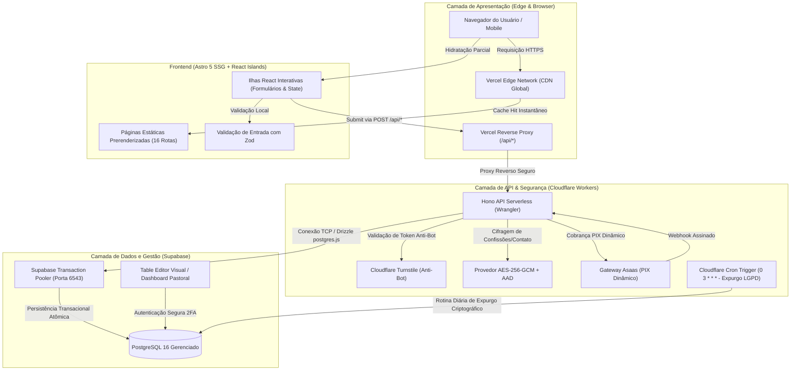

# Visão Geral do Sistema e Arquitetura

O sistema Pure Life Ministries Brasil adota uma arquitetura orientada a serviços leves e serverless, com separação rígida entre a camada de apresentação na borda, a API de regras de negócio/segurança e a camada de persistência confidencial.

---

## 1. Topologia do Sistema

---

## 2. Componentes Principais

### A. Frontend Web (`frontend`)
- **Framework**: Astro 5 configurado com `output: 'static'`.
- **Estilização**: Tailwind CSS v4 com tokens unificados na folha global. Zero CSS inline para compliance estrito com Content Security Policy (`style-src 'self'`).
- **Acessibilidade & Movimento**: Respeito estrito a `prefers-reduced-motion: reduce`, atributos ARIA dinâmicos (`aria-live`, `role="alert"`, `aria-describedby`) e foco visível em todos os controles interativos.
- **Roteamento Seguro**: Zero dependências de clientes de banco de dados no bundle (`@supabase/supabase-js` erradicado). Todas as submissões trafegam via Vercel Reverse Proxy (`/api/*`) para o backend na Cloudflare.
- **Formulários Interativos**:
  - `TriageForm.tsx`: Triagem confidencial com consentimento de sigilo pastoral.
  - `ContactForm.tsx`: Formulário de contato institucional.
  - `DonationForm.tsx`: Intenção de doação com suporte a PIX dinâmico e tratamento de erros explícito.
  - `newsletter-enhance.ts`: Captação progressiva de informativos por e-mail com fallback sem JavaScript.

### B. Backend na Borda (`backend`)
- **Runtime**: Cloudflare Workers com `compatibility_flags = ["nodejs_compat"]`.
- **Roteador & Middlewares**: **Hono** gerenciando cabeçalhos de segurança OWASP (`secureHeaders`), controle rigoroso de CORS por ambiente e limites de payload por rota (`bodyLimit`).
- **Criptografia de Campo em Repouso**: Provedor AES-256-GCM com Dados Adicionais Autenticados (AAD vinculando `entityType`, `entityId`, `field` e `keyVersion`) para proteção de dados confidenciais (Art. 11 LGPD).
- **Proteção Anti-Bot**: Porta hexagonal `BotProtectionPort` acoplada ao Cloudflare Turnstile com limite de tempo (`AbortSignal.timeout(3000)`).
- **Driver de Persistência**: `postgres.js` com `drizzle-orm/postgres-js`, habilitando suporte nativo a transações atômicas interativas (`db.transaction`) via Supabase Transaction Pooler (porta 6543) com `prepare: false`.
- **Idempotência**: Processamento de webhooks de pagamento baseado no modelo de lease atômico.
- **Expurgo Criptográfico Agendado**: Cloudflare Cron Trigger executando diariamente às 03:00 UTC em lotes seguros (`LIMIT 500`) com nulificação de dados em conformidade com o Artigo 16 da LGPD.

### C. Plataforma de Dados (`Supabase`)
- **Segurança de Linha (RLS)**: Tabelas protegidas com políticas granulares.
- **Isolamento de Segredos**: O banco não é exposto diretamente à Internet pública para gravações desprotegidas; todas as gravações sensíveis passam pelo isolamento do Worker.
- **Painel Administrativo**: A equipe pastoral utiliza o painel administrativo com controle de acesso granular e auditoria para despachar atendimentos.
