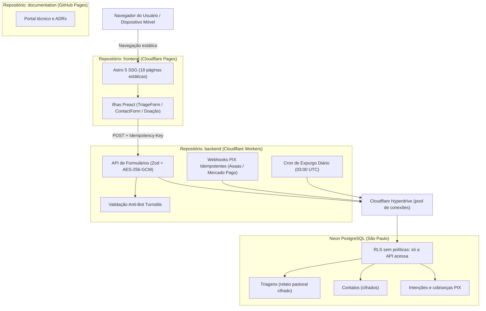

<div class="plm-hero">
  <span class="plm-eyebrow plm-rv">Documentação de engenharia</span>
  <h1 class="plm-title plm-rv" style="animation-delay: 0.06s">Tecnologia a serviço da <em>restauração</em>.</h1>
  <p class="plm-lead plm-rv" style="animation-delay: 0.12s">
    Arquitetura, contratos de dados, runbooks e decisões técnicas do portal institucional, da triagem pastoral confidencial (com controles de privacidade sob a LGPD) e das doações via PIX da Pure Life Ministries Brasil.
  </p>
  <div class="plm-actions plm-rv" style="animation-delay: 0.18s">
    <a href="operations/maintainer-guide/" class="plm-btn plm-btn--primary">Guia do Mantenedor <span class="plm-arrow">→</span></a>
    <a href="getting-started/quickstart/" class="plm-btn plm-btn--ghost">Rodar localmente</a>
    <a href="architecture/system-overview/" class="plm-btn plm-btn--ghost">Ver a arquitetura</a>
  </div>
  <div class="plm-stats plm-rv" style="animation-delay: 0.24s">
    <div class="plm-stat"><div class="plm-stat-num plm-count plm-count--3" data-value="3" aria-label="3"></div><div class="plm-stat-label">repositórios independentes</div></div>
    <div class="plm-stat"><div class="plm-stat-num plm-count plm-count--9" data-value="9" aria-label="9"></div><div class="plm-stat-label">decisões de arquitetura (ADRs)</div></div>
    <div class="plm-stat"><div class="plm-stat-num plm-count plm-count--5" data-value="5" aria-label="5"></div><div class="plm-stat-label">páginas de contratos de dados</div></div>
    <div class="plm-stat"><div class="plm-stat-num plm-count plm-count--180" data-value="180" aria-label="180"></div><div class="plm-stat-label">dias até o expurgo de triagens e contatos</div></div>
  </div>
</div>

## Comece por aqui

<div class="grid cards plm-reveal" markdown>

-   :material-pencil-box-outline: **Alterar textos, livros, conferência ou contatos**

    ---

    [:octicons-arrow-right-24: Guia do Mantenedor](operations/maintainer-guide.md)

-   :material-laptop: **Rodar o projeto no meu computador**

    ---

    [:octicons-arrow-right-24: Guia Rápido de Instalação](getting-started/quickstart.md)

-   :material-rocket-launch-outline: **Publicar ou desfazer uma publicação**

    ---

    [:octicons-arrow-right-24: Runbook de Implantação](operations/deployment.md)

-   :material-web-check: **Colocar o domínio oficial no ar**

    ---

    [:octicons-arrow-right-24: Checklist de Go-live](operations/go-live-checklist.md)

-   :material-shield-alert-outline: **Responder a um incidente**

    ---

    [:octicons-arrow-right-24: Resposta a Incidentes](operations/incident-response.md)

-   :material-package-up: **Tratar PRs do Dependabot e alertas**

    ---

    [:octicons-arrow-right-24: Dependências e Releases](quality/dependency-updates.md)

</div>

## Três repositórios, uma regra

> **"Front com Front, Back com Back e Docs com Docs."**

<div class="plm-repos plm-reveal">
  <a class="plm-repo" href="architecture/repositories-scope/#a-repositorio-frontend-front-com-front" style="text-decoration: none">
    <span class="plm-repo-name">frontend</span>
    <h3>Portal público</h3>
    <p>Páginas institucionais pré-renderizadas e ilhas de formulário. Nenhuma credencial no navegador.</p>
    <div class="plm-stack"><span class="plm-chip">Astro 5 SSG</span><span class="plm-chip">Tailwind v4</span><span class="plm-chip">Preact</span><span class="plm-chip">localhost:4321</span></div>
  </a>
  <a class="plm-repo" href="architecture/repositories-scope/#b-repositorio-backend-back-com-back" style="text-decoration: none">
    <span class="plm-repo-name">backend</span>
    <h3>API de borda e pagamentos</h3>
    <p>Turnstile, criptografia AES-256-GCM com AAD, webhooks PIX idempotentes e expurgo diário.</p>
    <div class="plm-stack"><span class="plm-chip">Cloudflare Worker</span><span class="plm-chip">Hono</span><span class="plm-chip">Neon + Hyperdrive</span><span class="plm-chip">localhost:8787</span></div>
  </a>
  <a class="plm-repo" href="architecture/repositories-scope/#c-repositorio-documentation-docs-com-docs" style="text-decoration: none">
    <span class="plm-repo-name">documentation</span>
    <h3>Engenharia e governança</h3>
    <p>ADRs, requisitos, modelagem de ameaças e runbooks. Este portal.</p>
    <div class="plm-stack"><span class="plm-chip">Material for MkDocs</span><span class="plm-chip">Mermaid</span><span class="plm-chip">localhost:8000</span></div>
  </a>
</div>

Comandos para iniciar cada repositório:

=== "frontend"

    ```bash
    pnpm dev
    ```

=== "backend"

    ```bash
    pnpm dev
    ```

=== "documentation"

    ```bash
    uv run --with-requirements requirements.txt mkdocs serve
    ```

O passo a passo completo de variáveis, dependências e banco está no [Guia Rápido de Instalação](getting-started/quickstart.md).

## Explore por área

<div class="grid cards plm-reveal" markdown>

-   :material-sitemap-outline: **Arquitetura**

    ---

    Visão do sistema, camadas, diagramas de sequência, modelo de dados e as ADRs 001 a 009.

    [:octicons-arrow-right-24: Visão Geral do Sistema](architecture/system-overview.md)

-   :material-code-json: **Contratos de dados**

    ---

    Esquemas `zod/mini` idênticos no frontend e no backend para triagem, contato, doação e newsletter.

    [:octicons-arrow-right-24: Contratos Comuns](schemas/common-schema.md)

-   :material-shield-lock-outline: **Segurança & LGPD**

    ---

    Modelagem de ameaças, criptografia de campo, RLS sem políticas e inventário de retenção.

    [:octicons-arrow-right-24: Modelagem de Ameaças](security/threat-model.md)

-   :material-clipboard-text-outline: **Requisitos & governança**

    ---

    Requisitos funcionais, regras de negócio, guia de estilo e glossário.

    [:octicons-arrow-right-24: Visão Geral (SRS)](requirements/index.md)

</div>

## Topologia e fluxo de dados


