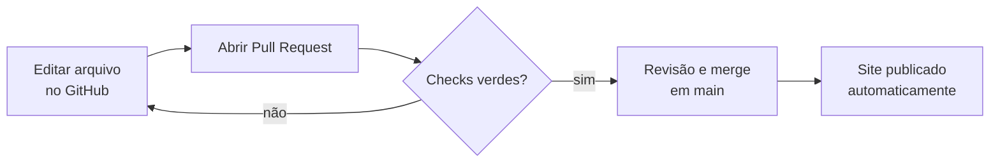

# Guia do Mantenedor

!!! abstract "Para quem é esta página"
    Para quem mantém o site no dia a dia — inclusive sem experiência em programação. Cada tarefa tem
    **onde mexer**, **como publicar** e **como conferir**. Para detalhes técnicos, siga os links.

## Como uma mudança chega ao ar

| Repositório | O que acontece ao mesclar em `main` |
|---|---|
| `frontend` (site) | Publica o site no Cloudflare Pages em cerca de 3 minutos |
| `documentation` | Publica esta documentação no GitHub Pages |
| `backend` (API) | **Nada é publicado sozinho**: use *Actions → Deploy API → Run workflow* |

Todo Pull Request roda verificações automáticas. **Nunca mescle com check vermelho.** A única
exceção conhecida é o PR da Política de Privacidade, que fica vermelho de propósito até os campos
`[PREENCHER]` serem preenchidos.

### Editar pelo navegador (sem instalar nada)

1. Abra o arquivo no GitHub (links nas tabelas abaixo) e clique no lápis (**Edit this file**).
2. Faça a alteração.
3. Em **Commit changes**, escolha **Create a new branch … and start a pull request**.
4. Aguarde os checks ficarem verdes. O check **Cloudflare Pages** mostra um link de prévia do site com a mudança.
5. Peça revisão e mescle.

## Tarefas frequentes do site

| Quero… | Arquivo (repositório `frontend`) | Observações |
|---|---|---|
| Mudar textos da página inicial | `src/components/home/*.astro` | Um arquivo por seção (Hero, Conferência, Livros, FAQ…) |
| Atualizar a conferência (data, tema, versículo) | `src/components/home/ConferencePreview.astro` e `src/pages/conferencia.astro` | Mude os dois: prévia da home e página completa |
| Adicionar ou alterar um livro | `src/pages/editora.astro` (lista `books`) e, se for destaque na home, `src/components/home/BooksPreview.astro` | Veja [Adicionar um livro](#adicionar-um-livro) |
| Perguntas frequentes | `src/pages/perguntas-frequentes.astro` e `src/components/home/FAQPreview.astro` | |
| WhatsApp, e-mail, chave PIX, redes sociais | `src/lib/site-config.ts` | Um único lugar para os dados de contato |
| Fotos do campus | `src/data/campus-photos.ts` + imagens em `src/assets/images/campus/` | |
| Depoimentos | `src/data/testimonials.ts` | |
| Viagem aos EUA | `src/data/usa-trip.ts` | |
| Política de Privacidade | `src/pages/politica-de-privacidade.astro` | Exige validação jurídica; ao mudar o texto, atualize `privacyPolicyVersion` em `site-config.ts` |

Mais detalhes: [Gestão de Conteúdo do Site](content-management.md).

### Adicionar um livro

1. Salve a capa em `src/assets/images/books/<nome-do-livro>.webp`, com cerca de **600 px de largura**
   (WebP; JPG também funciona — o site gera as versões otimizadas sozinho).
2. Em `src/pages/editora.astro`, importe a capa no topo:
   `import minhaCapa from "../assets/images/books/<nome-do-livro>.webp";`
3. Na lista `books`, copie um item existente e ajuste `id` (único, sem espaços), `title`, `author`,
   `price`, `audience`, `category` (`homens`, `mulheres`, `geral`, `devocional`, `restauracao`, `igreja`),
   `categoryLabel`, `desc` e `cover: minhaCapa`.
4. Confira título e autor **na própria capa** antes de publicar.

### Regras que o build verifica (e por quê)

| Se você… | O build falha porque… | Faça assim |
|---|---|---|
| usar `style="…"` no HTML | a política de segurança (CSP) bloqueia estilos inline | use classes Tailwind |
| colar `onclick="…"` | a CSP bloqueia scripts inline | peça ajuda técnica |
| deixar `[PREENCHER` na política | evita publicar política incompleta | preencha o campo |
| remover uma página da lista | `verify-topology` exige as 19 páginas | atualize `scripts/verify-topology.mjs` junto |

## Tarefas da API e do banco

| Quero… | Como | Referência |
|---|---|---|
| Publicar a API | *Actions → Deploy API → Run workflow* (destino `workersdev` até o domínio ficar ativo; depois `domain`) | [Implantação](deployment.md) |
| Desfazer uma publicação da API | `pnpm exec wrangler deployments list` e `pnpm exec wrangler rollback <version-id>` | [Implantação](deployment.md) |
| Aplicar uma migration | 1) criar branch de backup no Neon; 2) `pnpm db:migrate:dry-run`; 3) `pnpm db:migrate` | [Banco](../getting-started/database-setup.md) |
| Ler triagens e contatos | `node --env-file=.env scripts/pastoral-inbox.mjs list` (cada leitura fica auditada) | [CLI](cli-cheatsheet.md) |
| Trocar uma chave | Siga o runbook; nunca cole chaves em chat, issue ou commit | [Rotação de Chaves](key-rotation.md) |
| Ligar o bloqueio de abuso | `RATE_LIMIT_MODE = "enforce"` em `backend/wrangler.toml`, PR e Deploy API | [Modelo de Ameaças](../security/threat-model.md) |

## Rotina de manutenção

| Frequência | Tarefa |
|---|---|
| Semanal | Revisar e mesclar os PRs do **Dependabot** com checks verdes ([política](../quality/dependency-updates.md)) |
| Semanal | Ver alertas em *Security → Code scanning* (CodeQL) e *Dependabot alerts* |
| Semanal | Exportar backup do banco ([Backup & Recuperação](backup-recovery.md)) |
| Mensal | Rodar `./go-live-final.sh verify` (testes de fumaça, não alteram dados) |
| Mensal | Conferir logs e alertas ([Observabilidade](observability.md)) |
| Semestral | Revisar acessos (membros do GitHub, Cloudflare, Neon, Resend) e o [Modelo de Ameaças](../security/threat-model.md) |
| Anual | Renovar o domínio (vence em 16/08/2027) e revisar a Política de Privacidade |

## Quando algo der errado

1. **Site fora do ar ou quebrado após um merge**: Cloudflare → Workers e Pages → `purelife-site` →
   Deployments → **Rollback to this deployment** na última versão boa. Depois, reverta o PR no GitHub.
2. **Formulários falhando**: abra `https://<endereço-da-api>/health`. Se não for 200, reverta a API.
3. **Suspeita de vazamento de dados ou chave**: siga [Resposta a Incidentes](incident-response.md).
